<picture>
  <source media="(prefers-color-scheme: dark)" srcset="assets/header-dark.svg">
  
</picture>

  
  
  

### About me

Lead developer who owns the hard parts: **platform foundations**, **critical features** and the **technical decisions** that shape a product.

- **Architecture.** I design and ship distributed systems end to end: microservices, message-driven workflows, auth, CI/CD, Kubernetes on bare metal.
- **Security first.** My background covers pentesting, code audit and infrastructure hardening.
- **Product and engineering.** I turn business requests into feasible, sized plans, arbitrate urgencies, and lead teams and contractors to delivery.
- **Right now.** Leading a TypeScript microservices ERP, and building AI-assisted engineering workflows.

### Tech I work with

  
  
  
  
  
  
  
  
  
  
  
  
  
  

### Featured

| Project | What it does |
| --- | --- |
| **TAIPAN** | Plug-and-play penetration-testing appliance for pentesters and CISOs. Designed the whole infrastructure, the Flask core and the attack engines. *Python, Flask, Redis, RabbitMQ, Docker, Harbor.* |
| **ADAPA** | AI data-analysis and reputation-scoring platform. Designed the microservices, broker and workers architecture, and ran Kubernetes on bare metal. *Node.js, Python, React, RabbitMQ, Keycloak, Kong.* |
| [**agent-standup**](https://github.com/mohamedaziz/agent-standup) | Claude Code, Codex and Mistral Vibe sessions shown as a live, animated team call: who is working, who waits on whom, who needs you. VS Code extension, terminal command, desktop app. Runs locally, zero tokens. |

### In progress (private)

| Project | What it does |
| --- | --- |
| **Lead-tech agentic system** | Self-hosted multi-agent system that takes over a tech lead's operational work (tickets, merge requests, time tracking, mail), steered from a phone by text or voice. One isolated container per system, model-agnostic through an LLM gateway, every run traced and evaluated. All data stays on my machine. *Hermes Agent, LiteLLM, Langfuse, Docker, Telegram.* |
| **Claude Code toolkit** | Catalog of skills, agents and plugins with a gatekeeper, shared across projects: spec writing, review and delivery workflows, plus a plugin that designs and verifies 3D-printable parts. *Claude Code, Python, OpenSCAD, build123d.* |
| **Homelab** | Fully local, cloud-free lab: home automation, ESP32 sensors for an aquarium and plants, local AI. *Home Assistant, ESPHome, Raspberry Pi, Linux.* |

### Activity

  

Metrics refreshed daily by <a href="https://github.com/lowlighter/metrics">lowlighter/metrics</a>. CV built from <a href="cv.yaml"><code>cv.yaml</code></a> with <a href="https://github.com/rendercv/rendercv">RenderCV</a>.
