<p align="center">
  <a href="https://www.linkedin.com/in/mohamed-aziz-ben-rejeb"></a>
  <a href="mailto:mohamedazizbenrejeb@gmail.com"></a>
  <a href="https://github.com/mohamedaziz/mohamedaziz/releases/download/cv/Mohamed_Aziz_Ben_Rejeb_CV.pdf"></a>
</p>



```diff
+ owns the hard parts: platform foundations, critical features, technical decisions
+ ships distributed systems end to end: microservices, message-driven workflows, auth, CI/CD
+ security first: pentesting, code audit, infrastructure hardening
+ bridges product and engineering: feasibility, sizing, urgencies, contractors, delivery
- legacy without tests
```





<p align="center"><sub><code>cd</code> <a href="https://github.com/mohamedaziz/agent-standup"><b>agent-standup</b></a> · <code>cd</code> <a href="https://github.com/mohamedaziz/otto"><b>otto</b></a> · the rest is <code>chmod 700</code> for now</sub></p>



<details>
<summary><code>$ sudo rm -rf /legacy</code></summary>

```console
[sudo] password for aziz: ********
rm: cannot remove '/legacy': Device or resource busy (it still bills customers)
hint: write the tests first, then migrate. expand, then contract.
```

<sub>need someone who migrates legacy without breaking prod? <a href="mailto:mohamedazizbenrejeb@gmail.com?subject=sudo%20rm%20-rf%20%2Flegacy"><code>mail -s "sudo rm -rf /legacy"</code></a></sub>

</details>

<details>
<summary><code>$ fortune | cowsay</code></summary>

```
 __________________________________
< it works on my cluster. ship it. >
 ----------------------------------
        \   ^__^
         \  (oo)\_______
            (__)\       )\/\
                ||----w |
                ||     ||
```

<sub>the cow also ships CVs: <a href="https://github.com/mohamedaziz/mohamedaziz/releases/download/cv/Mohamed_Aziz_Ben_Rejeb_CV.pdf"><code>wget cv.pdf</code></a></sub>

</details>

<details>
<summary><code>$ man aziz</code></summary>

```
AZIZ(1)                       User Commands                       AZIZ(1)

NAME
       aziz - lead developer, platform foundations and hard features

SYNOPSIS
       aziz [--architecture] [--security] [--deliver] <problem>

DESCRIPTION
       Takes a fuzzy business request, returns a sized plan and a running
       system. Prefers boring tech, small diffs and tests that fail first.

EXIT STATUS
       0      shipped
       1      blocked on a decision that is yours to make

SEE ALSO
       plain(1), for readers who prefer a suit and tie
```

<sub><a href="plain/README.md">plain(1)</a></sub>

</details>

<sub><code>3 easter eggs above, 1 more in <b>cat README.md --raw</b>. found them all?</code></sub>

<!--
  $ echo eW91IGZvdW5kIGl0LiBtYWlsIG1vaGFtZWRheml6YmVucmVqZWJAZ21haWwuY29tIHdpdGggc3ViamVjdCAweEMwRkZFRQ== | base64 -d
-->




<sub><code>$ crontab -l</code> metrics refreshed daily by <a href="https://github.com/lowlighter/metrics">lowlighter/metrics</a> · CV compiled from <a href="cv.yaml"><code>cv.yaml</code></a> by <a href="https://github.com/rendercv/rendercv">RenderCV</a></sub>
<p align="right"><a href="plain/README.md" title="EOF: plain mode"><sub><code>^D</code></sub></a></p>
